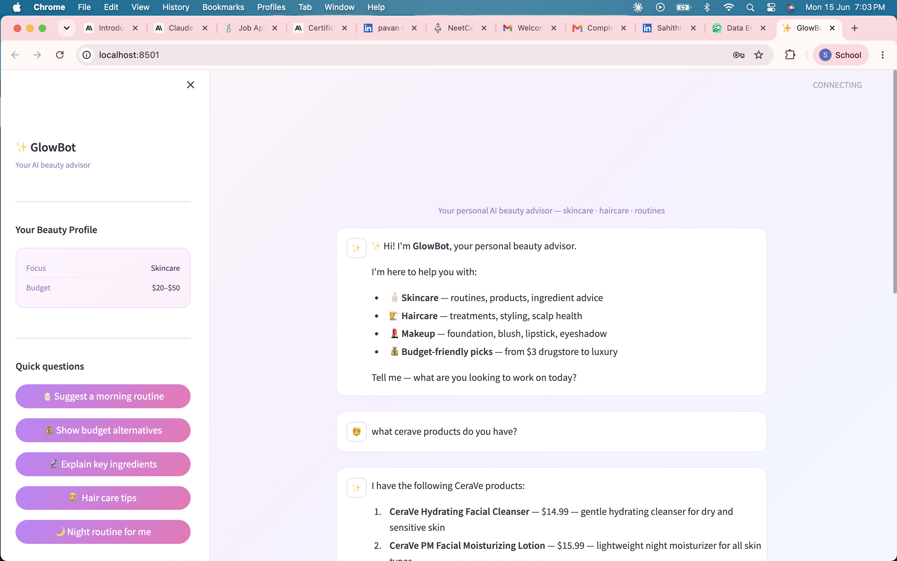
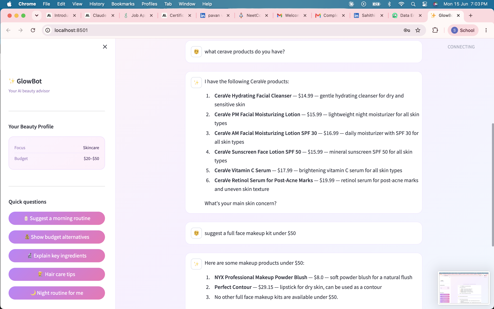

# ✨ GlowBot — AI Beauty Advisor Chatbot

> A polished AI beauty advisor built with **LangChain + Groq + Streamlit**. It recommends real beauty products based on the user's skin type, hair type, concern, and budget while keeping the experience elegant and highly readable in a dark premium UI.

---

## 🌸 What GlowBot Does

- 🧴 **Skincare advice** — routines, serums, moisturizers, and sunscreens for your skin type
- 💇 **Haircare advice** — shampoos, conditioners, treatments, and scalp care tips
- 💄 **Makeup recommendations** — foundation, blush, lipstick, mascara and more
- 💰 **Budget-aware suggestions** — price filtering from drugstore to luxury picks
- 🔬 **Ingredient-aware recommendations** — recommends products based on concerns like acne, dryness, dullness, and frizz
- 🧠 **Conversation memory** — remembers your beauty profile and context across chat turns
- 🎨 **Professional dark UI** — premium, readable design built for an elevated beauty-brand experience

---

## 🖥️ Screenshots





---

## 🛠️ Tech Stack

| Tool | Purpose |
|---|---|
| Python | Core application language |
| LangChain | LLM orchestration and message handling |
| Groq | LLM inference via Groq API |
| Streamlit | Chat interface and dark premium UI |
| JSON + smart keyword/ranking search | Beauty product retrieval with real product filtering |

---

## 🚀 Setup Guide

### Step 1 — Clone the repo
```bash
git clone https://github.com/sahithi-yerramsetty/Glow-beauty-chatbot.git
cd Glow-beauty-chatbot
```

### Step 2 — Install dependencies
```bash
pip install -r requirements.txt
```

### Step 3 — Get a Groq API Key

1. Go to **[console.groq.com](https://console.groq.com)**
2. Sign in or create an account
3. Open **API Keys** from the sidebar
4. Create a new key and copy it
5. Use the key in the app sidebar

> 💡 The app is configured to use a valid Groq model and works with the current supported Groq endpoint setup.

### Step 4 — Run the app
```bash
streamlit run app.py
```

### Step 5 — Open in browser

Streamlit usually opens at **http://localhost:8506**.

1. Paste your `gsk_` API key in the sidebar
2. Click **Start chatting ✨**
3. Ask for skincare, haircare, makeup, or budget-friendly recommendations

---

## 💬 Example Prompts to Try

```
"I have oily skin with dark spots, suggest The Ordinary serums under $20"
"I have curly frizzy hair, suggest K18 products"
"suggest a blush and lipstick under $10"
"I have sensitive skin with redness, what moisturizer should I use?"
"suggest a budget shampoo and conditioner under $10"
"I am in my 30s and worried about wrinkles, what serum should I use?"
```

---

## 📦 Product Database

A curated beauty product catalog across skincare, haircare, and makeup.

| Category | Count | Example Brands |
|---|---|---|
| 🧴 Skincare | 103 | CeraVe, La Roche-Posay, The Ordinary, Aveeno |
| 💇 Haircare | 71 | OUAI, K18, Kerastase, Moroccanoil, Mielle |
| 💄 Makeup | 111 | Maybelline, NYX, e.l.f., Milani, Wet n Wild |

---

## 📁 Project Structure

```
Glow-beauty-chatbot/
├── app.py              # Streamlit UI + chat interface
├── chatbot.py          # LangChain + Groq LLM + system prompt
├── vector_store.py     # Product search with brand detection + budget filtering
├── products.json       # 285 real beauty products database
├── requirements.txt    # Python dependencies
└── README.md
```

---

## 🧠 How It Works

```
User types message
        ↓
detect_focus() — skincare / haircare / makeup / combination
        ↓
build_search_context() — includes chat history and latest user prompt
        ↓
search_products() — smart beauty-intent search with brand + budget filters
        ↓
Ranking logic — relevance, category match, ingredients, concerns, rating
        ↓
Top recommendations injected into the LLM prompt
        ↓
Groq model generates a styled, personalized beauty response
        ↓
GlowBot replies with relevant product recommendations ✨
```

---

## 🔮 Future Improvements

- [ ] Add semantic/vector search for richer product matching
- [ ] Save beauty profiles per user account
- [ ] Allow skin selfie analysis and image-based recommendations
- [ ] Deploy with cloud hosting and persistent backend services
- [ ] Integrate live retailer pricing and stock data

---

## 👩‍💻 Built By

**Sahithi Yerramsetty** — AI Engineer  
[LinkedIn](https://linkedin.com/in/sahithi-yerramsetty) | [GitHub](https://github.com/sahithi-yerramsetty)

---

> ⭐ If you found this useful, give it a star on GitHub!